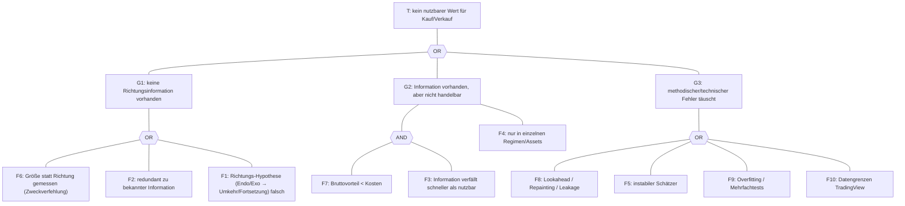

# Forensische Diagnose, Fault Tree Analysis und Entscheidung (Runde 2)

Datum: 2026-11-22. Untersuchungsgegenstand: `pine/ActivityPersistence.pine` (APX), eingefroren
als `pine/reference/ActivityPersistence_REFERENCE_72ae2de.pine`. Anlass: Der Indikator liefert
**keine Kauf- und Verkaufssignale**, und genau die werden für das Daytrading gebraucht.

---

## A. Forensische Bestandsaufnahme

| Ebene | APX |
|---|---|
| **A. Beobachtete Information** | Log-Spanne je Bar relativ zum Tageszeitprofil; HAR-Mittel; Volumenüberraschung; Vol-of-Vol; Schockzustand; Intrabar-Volumenkonzentration κ und Pfadlänge (1-Min-Bars); Vorlauf-Aufbau B vor Schocks. |
| **B. Interpretierte Information** | κ hoch / B ≤ 0 = „abrupt, exogen-artig“; B > 0 = „aufgebaut, endogen-artig“. |
| **C. Behauptete Prognosekraft** | Summe der Spannen der nächsten 12 Bars relativ zur Norm, also **richtungsneutral**. Abrupte Aktivität klingt schneller ab. |
| **D. Tatsächlicher Entscheidungsnutzen** | Belegt: +0,1 % (1m) bzw. +0,4 % (5m) MSE-Skill auf die künftige Spanne; auf 15m negativ. **Kein** belegter Nutzen für Ein- und Ausstiegsentscheidungen. |

**Logische Sprünge**
1. **Von C nach „Handelssignal“:** Eine Prognose der Bewegungs*größe* enthält keine Aussage über
   die *Richtung*. Wer APX als Kauf-/Verkaufsindikator verwendet, nutzt ihn für eine Aufgabe,
   für die er nie konstruiert wurde.
2. **Von B nach C:** „Konzentriertes Volumen = exogen“ ist eine Interpretation. News-Exogenität
   ist mit OHLCV nicht beobachtbar.
3. **Von statistischer Signifikanz nach Nutzen:** Ein Gewinn von 0,4 % MSE ist real, aber für
   eine einzelne Entscheidung kaum spürbar.

**Nie überprüft (vor Runde 2):** ob in den APX-Größen *Richtungsinformation* steckt; wie groß
eine Richtungsinformation sein müsste, um Kosten zu tragen; wie schnell die Information verfällt.

---

## B. Fault Tree

Top Event **T:** „APX erzeugt keinen robusten, zusätzlichen, wirtschaftlich nutzbaren
Informationswert für Intraday-Kauf- und -Verkaufsentscheidungen.“

G2 ist als AND modelliert: Eine vorhandene Information scheitert wirtschaftlich nur, wenn sie
zu klein für die Kosten ist und sich nicht durch längeres Halten skalieren lässt. Die Knoten
sind nicht unabhängig: F6a impliziert G1 für den Zweck „Richtung“, unabhängig von F2.

### Knotentabelle

| Knoten | Hypothetische Ursache | Erwartete Beobachtung | Test | Daten | Ergebnis | Evidenz | Konsequenz |
|---|---|---|---|---|---|---|---|
| **F6a** | APX misst Größe, nicht Richtung | Keine Prognosekraft für die signierte Rendite | **DX1**: Walk-Forward-OLS der signierten 12-Bar-Rendite; Richtungs-Baseline vs. Baseline + alle APX-Größen + Interaktionen mit der jüngsten Richtung | DEV, 5 Assets, 1/5/15m | Zusatz-Skill −0,4 % / +0,06 % (t = 0,01) / −2,9 %; Vorzeichen-Trefferquote **50,5 / 50,0 / 50,5 %** | **nachgewiesen** (stark) | APX ist als Signalgeber ungeeignet |
| **F1** | Richtungs-Folgerung aus Endo/Exo falsch | Kandidat C1 nicht besser als unbedingte Reaktion | Präregistrierte Ereignisstudie C1 | DEV | Netto (10 bp) −10 / −13 / −26 bp; brutto 15m signifikant **schlechter** als „alle ausfaden“ (t = −3,0) | **nachgewiesen** (stark) | Hypothese für Richtung verworfen |
| **F2** | Richtungsinformation, falls vorhanden, ist redundant | Kandidat schlägt Baseline U nicht | C1–C3 gegen U± | DEV | Kein Kandidat schlägt U signifikant (bestes: C3 5m +2,1 bp, t = 0,5) | **nachgewiesen** | – |
| **F7** | Bruttovorteil < Kosten | Brutto ≪ 10 bp | DX2 + Bruttostatistik aller Regeln | DEV | Größter signifikanter Bruttoeffekt: „alle Schocks ausfaden“ 5m **+0,86 bp** (t = 2,35). Break-even-Trefferquote bei 10 bp: 76 % (1m), 62 % (5m), 57 % (15m); im aktivsten Dezil 63 / 56 / 54 % | **nachgewiesen** | Selbst die existierende Umkehr ist ≈ 10× zu klein |
| **F3** | Information verfällt schnell | Skill sinkt mit Verzögerung | DX3: δ-Merkmale um k Bars verzögert | DEV | 5m: 0,77 % → 0,42 % (k = 3) → 0,11 % (k = 6) → 0 (k = 12); 1m bzw. 15m ähnlich, auf 15m bereits nach 3 Bars halbiert | **nachgewiesen** | Nutzbar höchstens wenige Bars nach Entstehung |
| **F4** | Regimeabhängig | Vorzeichen wechselt zwischen Jahren | Jahresweise Bruttowerte | DEV | Keine Regel in allen Jahren positiv, außer Mikro-Effekten < 1 bp (C3 1m, U− 1m) | plausibel | – |
| **F8** | Lookahead/Repainting | Unterschied historisch vs. Echtzeit | Trunkierungstest; Pine-Python-Parität; Echtzeit-Bars nur provisorisch | Runde 1 | Keine Abweichung; Parität bis auf Rundung | **ausgeschlossen** | – |
| **F5** | Instabiler Schätzer | Divergenz in langen Replays | Holdout-Replays v1–v3 | Runde 1 | RLS divergierte; durch Ridge (v3) behoben | **nachgewiesen und behoben** | Nicht Ursache von T |
| **F9** | Overfitting/Snooping | Gewinn verschwindet im Holdout | Holdout Runde 1; Präregistrierung Runde 2 | – | Volatilitätseffekt hielt zeitlich; Richtungseffekte scheiterten schon in DEV | ausgeschlossen als Ursache von T | – |
| **F10** | OHLCV enthält keine Richtungsinformation in dieser Größenordnung | Keine Regel brutto > Kosten | alle Tests | – | konsistent mit allen Befunden; Orderbuch/Orderflow (nicht verfügbar) nicht testbar | **plausibel, nicht beweisbar** | Grenze der Untersuchung |

**Hauptursachen:** F6a (Zweckverfehlung), F1 (Richtungs-Hypothese falsch) und F7 (Kosten),
alle nachgewiesen. Technische Fehler (F8) sind ausgeschlossen.

---

## C. Quantitative Tests Runde 2 (Daten, Methode, Ergebnisse)

* **Daten:** wie Runde 1 (Binance 1m, 5 Assets, 2023-01…2025-10 = DEV). Für Richtung
  unberührt und nach dem Abbruch **weiterhin unberührt**: Stufe A (2025-11…2026-10 + DOGE/ADA/
  LTC/LINK/AVAX) und Stufe B (2021-01…2022-12 + TRX/DOT/ATOM/BCH/NEAR, neu geladen).
* **Präregistrierung:** `docs/PREREGISTRATION_DIRECTION.md`, committet (800db6f) vor jeder
  Auswertung. Ereignis = Schock-Bar; Einstieg am Bar-Schluss; Ausstieg nach 12 Bars;
  nicht überlappend; Schwellen expandierend aus Vormonaten; Kosten 4/10/20 bp.
* **Skripte:** `validation/diagnose_apx.py` (DX1–DX3), `validation/direction_study.py`
  (C1–C3, U±).
* **Ergebnisse:** `results/diag_dx1.csv`, `diag_dx2.csv`, `diag_dx3.csv`,
  `direction_DEV_summary.csv`, `direction_DEV_gross.csv`.

| Regel (DEV) | 1m netto 10 bp | 5m | 15m | bestes brutto (t) |
|---|---|---|---|---|
| U+ (immer folgen) | −10,3 | −10,9 | −13,9 | – |
| U− (immer ausfaden) | −9,7 | −9,1 | −6,1 | 5m +0,86 bp (2,35) |
| C1 Abruptheit | −10,2 | −12,7 | −26,1 | – |
| C2 Volumen | −10,1 | −8,6 | −8,1 | 5m +1,4 bp (1,45) |
| C3 BTC→Alt | −9,1 | −6,9 | −16,6 | 1m +0,9 bp (1,60) |

Kein Kandidat besteht Kriterium 1 (alle Holm-p = 1,0). Laut Präregistrierung wurden die
Stufen A und B **nicht** ausgewertet.

---

## D. Entscheidung

| Verwendungszweck | Entscheidung | Begründung |
|---|---|---|
| APX als **Kauf-/Verkaufssignal** | **Option C – vollständige Verwerfung** | F6a, F1, F7 nachgewiesen. Es gibt keine Richtungsinformation, und auch die Richtungs-Folgerung aus der zugrunde liegenden Theorie scheitert. |
| Richtungs-Neukonstruktion (C1–C3) | **verworfen** | Alle präregistrierten Kandidaten scheitern bereits in DEV. Brutto-Effekte sind ≤ 1–3 bp bei 10 bp Kosten. |
| APX als **Risiko-/Volatilitätswerkzeug** | beibehalten, unverändert, **experimentell** | Der kleine, zeitlich replizierte Volatilitätseffekt aus Runde 1 bleibt bestehen. Er ist aber kein Signal. |

**Es wird kein neuer Signalindikator ausgeliefert.** Ein Pine-Skript mit Pfeilen wäre technisch
leicht zu bauen, würde aber nach allen Tests im Mittel Gebühren verlieren. Das wäre ein
erfundener Handelsvorteil.

---

## G. Wissenschaftliches Abschlussurteil

1. **Warum hat der ursprüngliche Indikator nicht funktioniert?** Er beantwortet eine andere
   Frage („Wie groß werden die Kerzen?“) als die gestellte („Kaufen oder verkaufen?“). Seine
   Größen tragen nachweislich keine Richtungsinformation (Trefferquote 50 %).
2. **Nachgewiesene Ursachen:** Zweckverfehlung (F6a), falsche Richtungs-Folgerung aus der
   Endo/Exo-Theorie (F1), Kostengeometrie (F7), schneller Informationsverfall (F3).
   **Hypothetisch:** dass OHLCV auf diesen Märkten generell keine kostendeckende
   Richtungsinformation enthält (F10). Getestet wurden nur die hier definierten Regeln, nicht alle denkbaren.
3. **Was wurde verändert oder verworfen?** Die Nutzung als Signalgeber wurde verworfen, ebenso
   drei neue Richtungs-Hypothesen. Der Code von APX blieb unverändert, nur die Dokumentation
   im Kopf wurde präzisiert.
4. **Zusätzliche Marktinformation der neuen Methode:** Keine. Die geprüften Kandidaten lieferten
   keine Richtungsinformation über die Baseline hinaus.
5. **Wie wurde getestet?** Präregistriert, Walk-Forward, expandierende Schwellen, nicht
   überlappende Trades, Kosten 4/10/20 bp, Tagesblock-HAC-t, Holm über 9 Tests.
6. **Evidenz für oder gegen einen Tradingnutzen:** Dagegen sprechen alle Netto-Ergebnisse
   (negativ in 9 von 9 Kombinationen). Dafür spricht nur eine winzige, signifikante kurzfristige
   Umkehr nach Schocks (+0,86 bp brutto auf 5m), rund zehnmal kleiner als die Kosten.
7. **Wann scheitert die Methode?** Als Richtungswerkzeug immer. Als Volatilitätswerkzeug auf
   15m und auf Assets, auf denen der Effekt nicht repliziert (ADA, AVAX, LINK).
8. **Was ist weiterhin nicht belegt?** Ob Märkte mit deutlich geringeren Kosten (Maker-Rabatte,
   < 2 bp) oder andere Datenquellen (Orderbuch, Liquidationsdaten, Funding, Open Interest; in
   TradingView teils verfügbar) eine kostendeckende Richtungsinformation liefern. Die Daten der
   Stufen A und B sind für Richtung weiterhin unberührt und stehen einer künftigen,
   **neu präregistrierten** Runde zur Verfügung.

**Offenes Forschungsproblem (statt erfundenem Vorteil):** *Gibt es auf liquiden Kryptomärkten
eine aus TradingView-verfügbaren Daten ableitbare Richtungsinformation mit einem Bruttovorteil
von mehr als ≈ 10 bp pro Trade auf einem Horizont von 1–3 Stunden?* Mit OHLCV-basierten
Ereignisregeln ließ sie sich hier nicht finden. Aussichtsreichere Datenquellen wären
Derivate-spezifische Größen (Funding, Open Interest, Liquidationen), die OHLCV nicht enthält.
